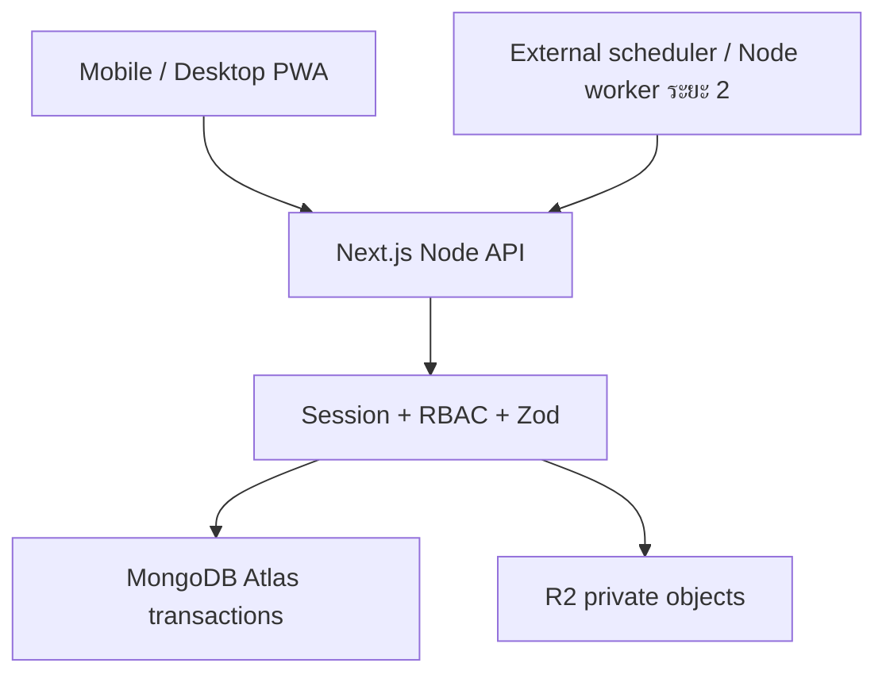

# แบบระบบ CMMS / MVP ระยะที่ 1
## ขอบเขตและสมมติฐาน
ระบบใหม่ Next.js Node runtime, MongoDB Atlas replica set เพื่อใช้ transactions, R2 private bucket. ไม่เชื่อมข้อมูลจากระบบเดิมโดยอัตโนมัติ. พนักงานมีหลาย site grants เป็นคู่ companyId/siteId; ไม่มีสิทธิ์ข้ามคู่. Supervisor ตรวจรับใบงาน แล้วผู้แจ้งยืนยันปิดคำขอ. MVP มีใบงานหนึ่งใบต่อคำขอ; backend ตรวจครบทุกใบงานก่อนปิด. เวลา UTC / แสดง Asia/Bangkok. SLA MVP ใช้ชั่วโมงปฏิทิน 4/24/72 ชั่วโมงตามความเร่งด่วน.

## Architecture

metadata ไฟล์ MVP เก็บ collection attachments ใน MongoDB เพื่อให้ตรวจสิทธิ์และผูกเอกสารได้ใน transaction. Requirement metadata ใน Cloudflare: ยังไม่ติดตั้ง D1 mirror ใน MVP; ต้องเพิ่ม outbox sync ในระยะถัดไป ห้ามถือว่า R2 custom metadata เป็นฐานข้อมูลสิทธิ์.

## Data model
ทุก record งาน/ทรัพย์สิน/สถานที่มี companyId, siteId; repairRequests requesterId, assetId optional, workOrders requestId, assigneeIds, status, revision. workLogs workOrderId, technicianId, start/end, cause, remedy, testResult. เงินเก็บ integer satang. sessions เก็บ SHA256 ของ opaque token + expiry. auditLogs immutable insert ใน transaction เดียวกับสถานะ. documentSequences atomic $inc ใน transaction; unique number index ป้องกันซ้ำ. idempotency key สร้างคำขอเป็น UUID ต่อผู้ใช้ พร้อม unique index. ข้อมูลหลักใช้ deletedAt soft delete; ไม่ลบประวัติ.

|กลุ่ม collections|Relationships / indexes|
|---|---|
|users, roles|username unique, scoped grants; roles ใน code MVP|
|companies, sites, locations, departments, maintenanceTeams|site company FK; location site FK; deletedAt|
|assets, assetMeterReadings|asset code per site unique; readings asset/time|
|repairRequests, workOrders, workLogs|number unique; requester/site/status; workOrder request unique MVP; logs workOrder/time|
|attachments, comments, notifications, auditLogs|parent collection/id + company/site; audit entity/time|
|documentSequences, systemSettings|sequence scope/kind/year unique|
|pmTemplates, pmPlans, pmOccurrences, pmResults|ระยะ 2: plan/asset/cycle unique; version/checklist snapshots|
|downtimeEvents, spareParts, sparePartTransactions|ระยะ 3: asset/time + asset lock ป้องกันซ้อน; movement idempotency unique|

## Workflow
Request pending → approved (transaction สร้าง WO) → in_progress → awaiting_acceptance → closed. rejected/cancelled ต้องเหตุผล. WO unassigned → assigned → accepted → in_progress ↔ waiting_parts/waiting_contractor → review → completed. Supervisor เปิดกลับ review → in_progress พร้อมเหตุผล. Technician ส่ง review ต้องมี log และ test result. Request ปิดเมื่อ WO ทุกใบ completed เท่านั้น.

|บทบาท|อ่าน|เขียน|
|---|---|---|
|requester|คำขอตนเอง + WO ที่เกี่ยวข้อง|สร้าง/ความคิดเห็น/ยืนยันปิด/ประเมิน|
|technician|WO ที่ได้รับมอบหมาย + คำขอต้นทาง|รับงาน/เริ่ม/รอ/บันทึก/ส่งตรวจ|
|supervisor|ทุกงานใน site grants|อนุมัติ/มอบหมาย/ตรวจรับ/เปิดกลับ|
|executive|ทุกงานใน site grants|ไม่มีสิทธิ์แก้|
|admin|ทุกงานใน site grants|หัวหน้างาน + users/master|

## หน้าจอ / โครงสร้าง
Login, dashboard counters, requests list/new/detail, WO list/detail, assets list/detail/QR, master management, users, profile. Mobile cards / desktop grid, filter/page. src/app/api/[...path]/route.ts เป็น API router; src/lib auth/domain/db; scripts/setup.ts; docs คู่มือ. ไม่มี PM หรือรายงานปลอม.

## ระยะถัดไป
PM occurrence key plan+asset+cycle; immutable snapshot; calendar Bangkok clamp สิ้นเดือน; fixed schedule default; missed cycles สร้างย้อนหลังทีละรอบพร้อม cap และ alert; meter reset มี epoch; hybrid lock หนึ่ง occurrence เมื่อถึงก่อน; completion-based รอ completion ก่อนเลื่อนฐาน. Worker ต้อง lease/transaction และ retry. Email outbox dedupe event+recipient+channel; ไม่รับรอง exactly-once ที่ provider ไม่รองรับ idempotency.
KPI: PM ตรงเวลา = completedOnOrBeforeDue / occurrencesDueInPeriod *100; MTTR = corrective downtime duration / completed failure episodes; MTBF = actual operating hours / failure count. ค่าไม่พอแสดงข้อมูลไม่เพียงพอ. Downtime clip ช่วงรายงานและ union intervals; ห้ามใช้ labor hours แทน operating hours.
